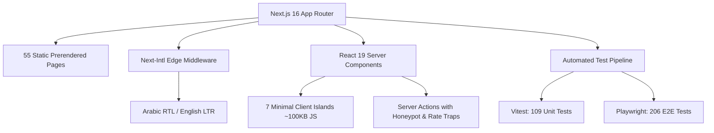

# Case Study: Hadramout Research Center Web Platform

> **Client:** Hadramout Research Center (مركز بحوث حضرموت)  
> **Affiliation:** Al-Ahgaff University, Mukalla, Yemen  
> **Agency / Studio:** Novixa Digital Solutions (نوڤيكسا للحلول الرقمية)  
> **Timeline:** 10 Sprints (Discovery to Production Release)  
> **Status:** Production Ready · Tagged `v1.0.0`

---

## Executive Summary

The **Hadramout Research Center (HRC)** web platform is a custom-engineered, bilingual (Arabic-first / English) institutional web application built to establish an authoritative digital presence for one of Eastern Yemen’s premier academic research and training institutions.

Designed and developed by **Novixa**, the platform serves dual strategic mandates:
1. **For HRC:** Provides a dignified digital portal, showcasing the *Al-Ahgaff Journal for Social Sciences*, academic conferences, vocational diplomas, community training, and structured contact/consultation pathways.
2. **For Novixa:** Demonstrates portfolio-grade technical craftsmanship in higher education and research technology, featuring 100% WCAG 2.2 AA accessibility, zero-waterfall static delivery, and an authentic Hadrami cultural design system.

---

## 1. The Challenge

Established in December 2013, HRC has conducted essential socioeconomic research, published peer-reviewed journals, and graduated cohorts across vocational and linguistic diplomas. However, its online visibility was previously limited to fragmented social media announcements and sub-pages within the university's domain.

Specific architectural challenges included:
- **Absence of Dedicated Identity:** The Center required an independent digital visual language reflecting its Hadrami heritage while honoring its Al-Ahgaff University affiliation.
- **Bilingual Scholarly Parity:** Academic research centers require dignified, scholarly Arabic phrasing without compromising English international discoverability.
- **Fact Verification & Institutional Integrity:** A public research institution cannot publish unverified names, dates, or prices; every data point required rigorous verification gating.
- **Low-Bandwidth & Device Diversity:** Visitors in Yemen and the diaspora access the portal across unstable 3G/4G connections and legacy mobile devices.

---

## 2. The Solution & Design Philosophy

### Authentic Hadrami Aesthetic (Anti-AI-Smell)
Novixa rejected generic modern templates, neon gradients, and floating bubbles in favor of a timeless, scholarly aesthetic rooted in the architectural heritage of Hadramout:
- **Visual Motif:** Custom eight-point Hadrami architectural star (`نجمة`) integrated as a subtle vector mark, watermark, and dynamic Open Graph card motif.
- **Dignified Palette:** Warm paper background (`--slate-50`), deep institutional indigo (`--navy-500`), and warm sand/bronze accents (`--bronze-600`), rigorously tested for WCAG AAA text contrast.
- **Typographic Authority:** Classical serif display pairing `Amiri` (Arabic) and `EB Garamond` (Latin) for prestigious academic titles, complemented by `IBM Plex Sans Arabic` and `Inter` for crisp readability.

---

## 3. Technical Architecture

The platform was built with a **docs-first, zero-bloat** engineering methodology:

### Key Engineering Pillars
- **Next.js 16 (App Router) & React 19:** 55 static pages generated ahead of time (SSG), eliminating server compute latency and ensuring instant TTFB.
- **True Static Parity:** Complete route symmetry across 13 route types (`/ar` and `/en`), with automated hreflang alternates, canonicals, and multi-language sitemaps.
- **Minimal Client Footprint:** Only 7 client component islands across the entire application; total client JavaScript payload is restricted to ~100 KB gzipped.
- **Progressive Enhancement:** Fully functional without client JavaScript; server actions process form submissions natively via standard HTML form posting.
- **Schema.org Structured Data:** 13 JSON-LD models validated across all routes (`EducationalOrganization`, `ScholarlyArticle`, `Course`, `Event`, `BreadcrumbList`).

---

## 4. Quality & Performance Metrics

The project underwent an exhaustive 8-stage automated and manual QA matrix:

| Metric | Industry Standard | HRC Platform Result |
|---|---|---|
| Lighthouse Accessibility | 90 | **100 / 100** |
| Lighthouse SEO | 90 | **100 / 100** |
| Lighthouse Best Practices | 90 | **100 / 100** |
| Cumulative Layout Shift (CLS) | < 0.10 | **< 0.031** (measured via PerformanceObserver) |
| Automated E2E Matrix | — | **206 / 206 tests passing** (Chromium + Mobile Pixel 7) |
| Unit Test Coverage | — | **109 / 109 tests passing** (9 suites) |
| WCAG 2.2 Compliance | Level AA | **Level AA & AAA Verified** (Zero axe-core violations) |
| Static Build Time | — | **15 seconds** (55 static pages generated cleanly) |

---

## 5. Client Impact & Handover

Novixa delivered an end-to-end client handover pack enabling autonomous operations by HRC staff:
1. **Step-by-step Hosting Guide:** Zero-downtime deployment instructions for Vercel and university Linux VPS.
2. **MDX Content Authoring Guide:** Non-technical editing instructions for news posts, training programs, journal issues, and team rosters.
3. **Institutional Content Checklist:** 36-point verified data register to track client confirmations safely.
4. **Launch Social Media Kit:** Bilingual announcement templates formatted for Facebook and Instagram.

---

## 6. Studio Reflection

> *"The HRC project demonstrates that institutional websites for research and academic bodies do not need heavy corporate CMS frameworks to be modern, accessible, and easily maintainable. By combining Next.js static generation with an authentic regional identity and strict documentation standards, Novixa created a digital asset worthy of Hadramout’s scholarly tradition."*  
> — **Novixa Engineering & Design Team**
